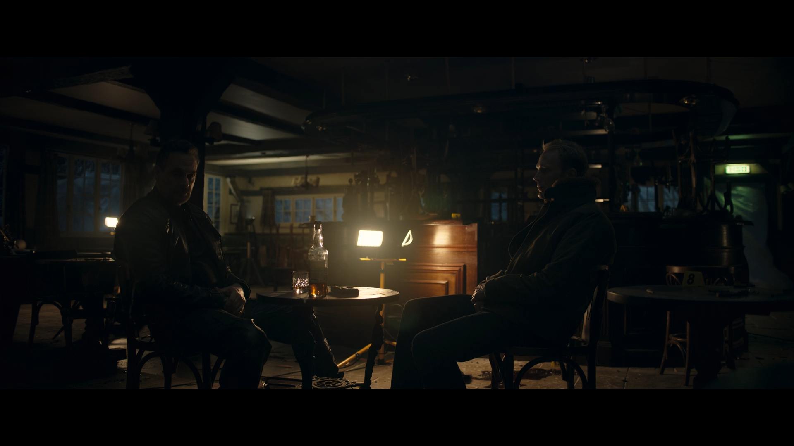
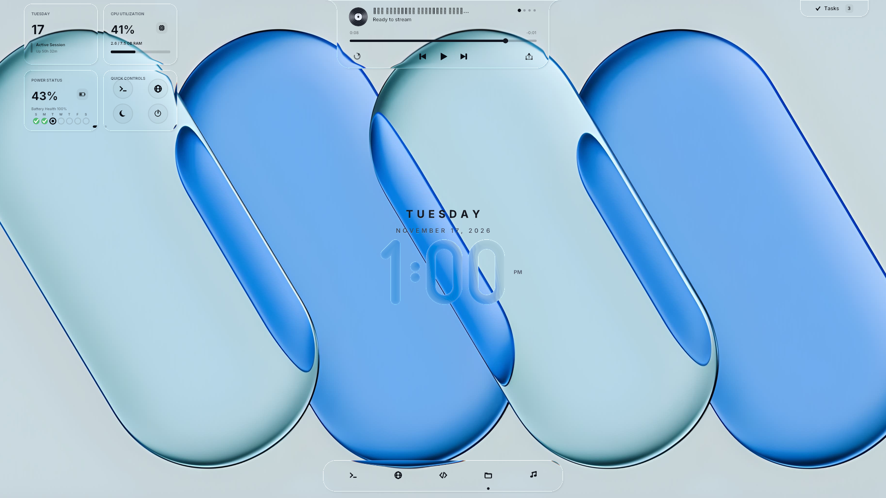

<div align="center">

# 🔱 Atlantis

### Turnkey Physical Optical Glass Desktop Environment for Wayland

> **Cross-Platform Editions**: [Linux / Wayland (`atlantis`)](https://github.com/ziuus/atlantis) · [Windows 10/11 (`atlantis-win`)](https://github.com/ziuus/atlantis-win) · [macOS (`atlantis-mac`)](https://github.com/ziuus/atlantis-mac) · [Core Engine (`liquid-glass`)](https://github.com/ziuus/liquid-glass)

[](https://wayland.freedesktop.org)
[](https://github.com/ziuus/liquid-glass)
[](LICENSE)

<br />



<br />

*Complete physical optical glass desktop suite with Snell refraction, Cauchy chromatic dispersion, tactile spring kinetics, and dynamic ambient lighting.*

<br />



<br />

</div>

---

## 🔮 Components

1. **Liquid Dynamic Island**:
   - Floating compact capsule expanding on hover or click with fluid RK4 spring physics.
   - **Hardware HUD & Sliders**: Real-time curved glass volume & brightness popups (`wpctl` & `brightnessctl`) with speaker icon, percentage badge, and smooth glow rails.
   - **Wheel-Scroll Volume**: Mouse wheel scroll directly over the compact capsule to instantly adjust audio volume with live HUD feedback.
   - **Interactive Media Player**: Spinning vinyl disc, progress scrub bar, animated equalizer, and playback controls.
   - **Audio Output Switcher**: Instant PipeWire sink cycle (`wpctl`) with live device toast notification.
   - **Dynamic Status Metrics**: Real-time network connectivity indicator (emerald online, amber offline) and battery level.
   - **System Overview**: Live CPU, RAM, Uptime, Battery telemetry with one-click `btop` launcher.
   - **Quick Access Drawer**: Instant application launcher grid.
   - **Safe Power Menu**: Hold-to-confirm reboot, shutdown, suspend, and lock actions.

2. **Center Hero Clock**:
   - Giant 3D liquid glass numerals rendered via pure physical Snell refraction.
   - Crystalline optical contrast adapting dynamically to dark, light, and vibrant wallpapers.
   - 360-degree Fresnel perimeter rim lighting with harmonic wallpaper light-guiding.

3. **Liquid Glass App Dock**:
   - Bottom-docked glassmorphism bar with pinned application launchers and launch-glow indicators.

4. **Interactive Todo & Agenda Island**:
   - Top-right floating glass island with live task management and calendar integration.

---

## 🚀 Turnkey Installation

### One-Line Automated Installer

```bash
curl -sSL https://raw.githubusercontent.com/ziuus/atlantis/master/install.sh | bash
```

### From Source

```bash
git clone https://github.com/ziuus/atlantis.git
cd atlantis
./install.sh --systemd
```

### Arch Linux (PKGBUILD)

```bash
cd atlantis
makepkg -si
```

---

## 🎮 CLI Control (`atlantis-ctl`)

Control the desktop from your keyboard shortcuts, Hyprland binds, or terminal:

```bash
# Navigation & Modes
atlantis-ctl toggle           # Toggle island visibility
atlantis-ctl music            # Jump directly to Music player
atlantis-ctl system           # Jump to System Overview
atlantis-ctl apps             # Jump to Quick Access app drawer
atlantis-ctl power            # Jump to Power menu

# Hardware HUD & Audio
atlantis-ctl volume-up        # Increase volume & trigger glass HUD
atlantis-ctl volume-down      # Decrease volume & trigger glass HUD
atlantis-ctl volume 70        # Set volume to exact percentage
atlantis-ctl mute             # Toggle mute state
atlantis-ctl sink             # Switch audio output device
atlantis-ctl brightness-up    # Increase display brightness
atlantis-ctl brightness-down  # Decrease display brightness

# Aesthetics & Theme
atlantis-ctl theme cycle      # Cycle Auto -> Dark -> Light
atlantis-ctl style cycle      # Cycle Obsidian -> Frosted -> Liquid Glass
```

---

## ⚙️ Core Engine

Atlantis is built on the **Liquid Glass Physical Rendering Engine**:
- **Repository**: [https://github.com/ziuus/liquid-glass](https://github.com/ziuus/liquid-glass)
- Pure Rust, headless WGPU + WGSL physical optical rendering pipeline with RK4 spring physics.
